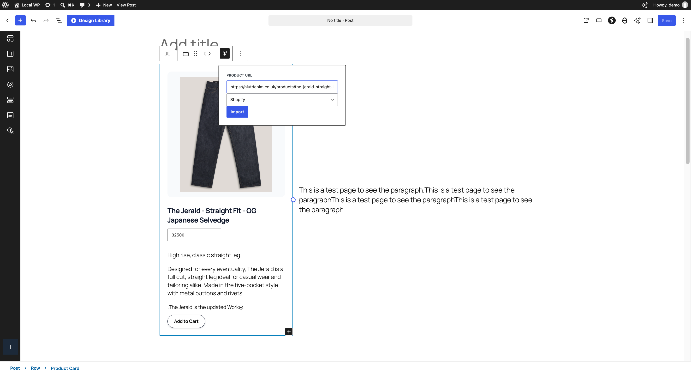
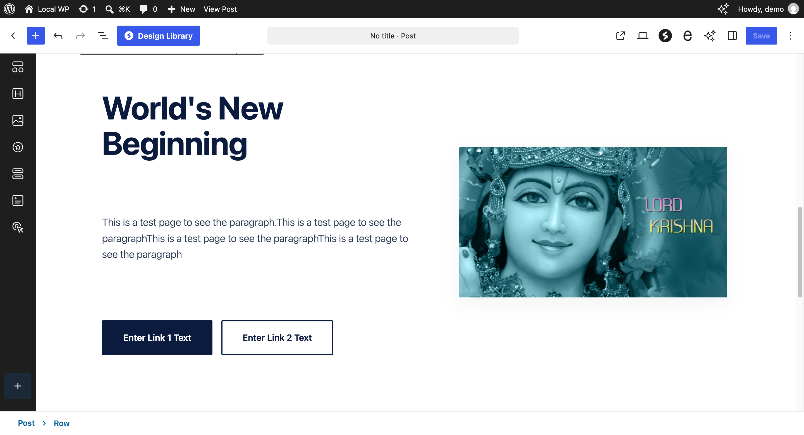
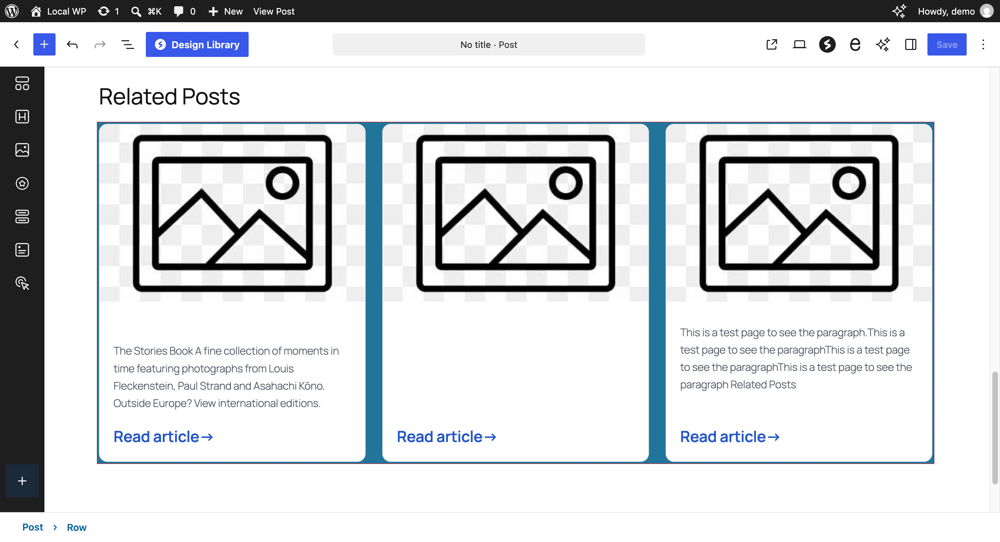

# AVCL Blocks

[](https://github.com/ankur0007/wp-gutenberg-blocks/actions/workflows/ci.yml)

AVCL Blocks is a collection of Gutenberg blocks for building page layouts,
showcasing products, and displaying related content.

## Blocks

### Product Card

Create a product card with an image, title, price, description, and button.
Use the block toolbar's **Import product** control, paste an HTTPS Shopify
product URL, and choose **Import**. The importer fills available product details
and the primary image; the card's inner blocks can still be edited in WordPress.



### Hero Section

Start with a hero layout containing a heading, paragraph, two buttons, and an
image. Replace the placeholder content and set the button labels, destinations,
and image in the editor.



### Related Posts

Display a grid of posts with featured images, titles, excerpts, and links.
Select the post type and choose how many posts to show (1–10) in the block
settings. On a single post, the current post is excluded.



*Screenshots show the blocks in the WordPress editor.*

## Shopify importer

The Product Card importer tries several public storefront methods in sequence:

1. Shopify's product `.js` endpoint.
2. Shopify's product `.json` endpoint.
3. A storefront GraphQL request to discover the store's cookie domain, followed
   by a product `.js` request.
4. A derived `{store-name}.myshopify.com` product URL, tried with `.js` and
   `.json`.

Product details can include the title, description, price, vendor, category,
image gallery, and variants.

The importer uses public storefront endpoints. Storefronts may block or limit
access, and a custom domain may not identify the store's original
`myshopify.com` domain. It supports many Shopify stores, but cannot guarantee
access to every store or bypass authentication and storefront restrictions.

## Requirements

- WordPress 6.8 or later
- PHP 7.4 or later

## Installation

1. Download the repository as a ZIP file (or clone it).
2. Place the extracted repository directory in `/wp-content/plugins/`.
3. Activate **AVCL Blocks** from the WordPress Plugins screen.
4. Open a post or page, select **+** to open the block inserter, and search for
   **Product Card**, **Hero Section**, or **AVCL Related Posts**.

## Development and checks

Requirements: Node.js 20+ and npm. Install dependencies, then build:

```sh
npm install
npm run build
```

Start the development watcher with:

```sh
npm start
```

The GitHub Actions workflow builds the blocks and checks PHP syntax on PHP 7.4
and PHP 8.3. Before opening a pull request, run:

```sh
npm run build
find . -type f -name '*.php' ! -path './vendor/*' ! -path './node_modules/*' -print0 | xargs -0 -n 1 php -l
```

## Contributing

Bug reports and feature requests are welcome through
[GitHub Issues](https://github.com/ankur0007/wp-gutenberg-blocks/issues).
Please read [CONTRIBUTING.md](CONTRIBUTING.md) before submitting changes.

## Changelog

See [CHANGELOG.md](CHANGELOG.md).

## License

AVCL Blocks is licensed under the GNU General Public License, version 2 or (at
your option) any later version. See [LICENSE](LICENSE).
